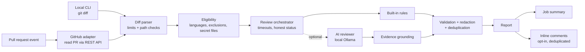

# PR Guardian

> Catch evidence-backed problems in pull requests before they reach production.

PR Guardian reviews GitHub pull requests with deterministic rules and an optional local AI
reviewer, and reports what it finds as a job summary and inline comments on the changed lines. Every
finding names a file and line, quotes the evidence, and says where it came from. It is an
assistant, not an authority: **a review with no findings does not mean the code is correct or
secure.**

**v1.0.0** · TypeScript · GitHub Action + CLI · MIT · [evaluation](docs/evaluation.md) ·
[security model](docs/security.md) · [architecture](docs/architecture.md) · [demo](docs/demo.md)

## Why

AI code reviewers are easy to build and hard to trust: they invent issues, cite lines that do not
exist, can be steered by text in the code they review, and present a quiet run as a clean bill of
health. PR Guardian is built around the opposite defaults:

- **Evidence or nothing.** Findings are schema-validated and must point at a real changed line;
  model output that cannot be grounded in the diff is dropped.
- **Deterministic first.** Fast rules are the reproducible baseline; AI is optional and local.
- **Honest status.** Every review is _Completed_, _Completed with limitations_ or _Failed_; a
  failed analyzer never looks like a clean review.
- **Safe by construction.** Pull request code is never executed, the Action needs read-only
  permissions by default, and report text is escaped so a PR cannot inject HTML or mentions.

## Example

The demo pull request ([PR #1](https://github.com/Emannnqt/pr-guardian/pull/1), an intentionally
insecure sample) adds a deploy helper. The start of PR Guardian's report, as generated for that diff:

````markdown
## PR Guardian review

**Status:** ✅ Completed · **Mode:** rules-only · **Reviewer:** v1.0.0

2 findings (2 high) in 1 analyzed file.

### Findings

#### High (2)

##### 1. Shell command built with string interpolation

- **Location:** `demo/insecure-example.ts` line 6
- **Category:** security · **Confidence:** 0.60 · **Source:** static-analysis (`builtin/shell-command-interpolation`)

`exec`/`execSync` run their argument through a shell. Interpolating values into the command string allows command injection if any value can be influenced by a user.

**Evidence**

```text
execSync(`git push origin ${branch}`);
```

**Suggested fix:** Use `execFile`/`spawn` with an argument array (no shell), or strictly validate every interpolated value.

…
````

With `inline-comments: true` the same findings appear as review comments on those lines, and a
re-run adds nothing new. Full sample reports: [`fixtures/expected-reports/`](fixtures/expected-reports/)
(for example [insecure-changes.md](fixtures/expected-reports/insecure-changes.md) and the
[hybrid version](fixtures/expected-reports/insecure-changes.hybrid.md)).

## Architecture

A modular monolith in one Node.js process. The core never talks to GitHub or a model directly;
adapters do, behind narrow interfaces, and lint rules enforce the boundaries.



Details and the decision log: [docs/architecture.md](docs/architecture.md).

## Languages and modes

- **Languages:** TypeScript and JavaScript (`.ts .tsx .mts .cts .js .jsx .mjs .cjs`). Other files
  are listed as not analyzed.
- **Rules-only** (default, CLI and Action): the built-in rules below. No network, no model.
- **Hybrid** (CLI only): rules plus a local model through [Ollama](https://ollama.com).

| Rule                                  | Severity | Flags                                                                    |
| ------------------------------------- | -------- | ------------------------------------------------------------------------ |
| `builtin/hardcoded-secret`            | high     | AWS, GitHub, Slack, Stripe, Google, Anthropic, OpenAI keys; private keys |
| `builtin/tls-verification-disabled`   | high     | `rejectUnauthorized: false`, `NODE_TLS_REJECT_UNAUTHORIZED = '0'`        |
| `builtin/shell-command-interpolation` | high     | `exec`/`execSync` with an interpolated template literal                  |
| `builtin/dynamic-code-execution`      | medium   | `eval`, `new Function`, string arguments to `setTimeout`/`setInterval`   |
| `builtin/focused-test`                | medium   | `.only`, `fit`, `fdescribe`                                              |
| `builtin/debugger-statement`          | low      | `debugger`                                                               |

Rules match code, not text: patterns inside string literals and comments are ignored. Detected
secrets are redacted in every output.

## Quick start (local)

Requires Node.js **22.12+** (24 LTS recommended; see [`.nvmrc`](.nvmrc)).

```sh
git clone https://github.com/Emannnqt/pr-guardian.git && cd pr-guardian
npm ci
npm run build
node dist/cli/index.js review fixtures/diffs/insecure-changes.diff   # sample review
git diff main...HEAD | node dist/cli/index.js review -               # review your own change
```

| Option                      | Default      | Meaning                                                   |
| --------------------------- | ------------ | --------------------------------------------------------- |
| `--format markdown\|json`   | `markdown`   | Report format                                             |
| `--min-severity <level>`    | `low`        | Lowest severity listed; hidden findings are still counted |
| `--fail-on <level>`         | (none)       | Exit 1 if a listed finding is at or above this severity   |
| `--mode rules-only\|hybrid` | `rules-only` | Add the local AI reviewer                                 |

**Exit codes:** `0` completed (possibly with limitations) · `1` `--fail-on` met · `2` usage error ·
`3` review failed. Reviews are advisory unless you pass `--fail-on`.

## GitHub Action

Add `.github/workflows/pr-guardian.yml` to your repository:

```yaml
name: PR Guardian
on:
  pull_request:
    types: [opened, synchronize, reopened]
permissions:
  contents: read
  pull-requests: write # only needed for inline-comments; use "read" otherwise
jobs:
  review:
    runs-on: ubuntu-latest
    timeout-minutes: 5
    steps:
      - uses: Emannnqt/pr-guardian@v1 # or pin a full commit SHA
        with:
          inline-comments: true
          # fail-on: high            # optional; omit for advisory-only reviews
```

The report appears as the run's job summary (PR **Checks** tab → **PR Guardian** → **Summary**).
The Action reads the change through the GitHub API and never checks out or executes pull request
code. Pull requests from forks get a read-only token: the summary still works and inline comments
are skipped with a notice.

| Input                 | Default               | Meaning                                                                   |
| --------------------- | --------------------- | ------------------------------------------------------------------------- |
| `min-severity`        | `low`                 | Lowest severity listed; hidden findings are still counted                 |
| `fail-on`             | (empty)               | Fail the step if a listed finding is at or above this severity            |
| `inline-comments`     | `false`               | Also post inline comments on changed lines (needs `pull-requests: write`) |
| `max-inline-comments` | `10`                  | Most inline comments per run (1–50); the rest stay in the summary         |
| `exclude-paths`       | (empty)               | Extra paths to skip, one per line, e.g. `src/generated`                   |
| `max-files`           | `300`                 | Fail the review above this many changed files (can only be lowered)       |
| `max-file-bytes`      | `100000`              | Skip files with a larger diff (can only be lowered)                       |
| `comment-author`      | `github-actions[bot]` | Whose comments count as PR Guardian's (change only for custom tokens)     |
| `github-token`        | `${{ github.token }}` | Token used to read the PR (and post comments)                             |

Outputs: `status`, `finding-count`, `inline-comments-posted`, `report-path` (full JSON report).
The step fails when the review fails, `fail-on` is met, or enabled inline comments could not be
posted; it passes with a warning when the review completed with limitations.

**Inline comments** are posted as one `COMMENT` review per run (never approve or request changes),
only on added lines. Each carries a hidden fingerprint, so re-runs skip findings that already have
a PR Guardian comment on that line; only comments by `comment-author` count, so a pasted marker
cannot hide a finding. PR Guardian never edits or deletes comments.

**Making it enforceable:** a pull request can edit workflow files, so mark the check as required
in branch protection and protect `.github/` with CODEOWNERS. See [docs/security.md](docs/security.md).

## AI review (local, optional)

```sh
ollama pull qwen2.5-coder:3b     # ~1.9 GB, runs on CPU
node dist/cli/index.js review changes.diff --mode hybrid --ai-model qwen2.5-coder:3b
```

| Option                   | Default                  | Meaning                                               |
| ------------------------ | ------------------------ | ----------------------------------------------------- |
| `--ai-model <name>`      | (required)               | Ollama model; or set `PR_GUARDIAN_AI_MODEL`           |
| `--ai-endpoint <url>`    | `http://127.0.0.1:11434` | Ollama URL; or set `PR_GUARDIAN_AI_ENDPOINT`          |
| `--ai-timeout <seconds>` | `300`                    | Time limit for the model                              |
| `--allow-remote-ai`      | off                      | Required for any endpoint that is not on this machine |

- **What the model sees:** only the changed hunks, inside per-request nonce delimiters, labeled as
  untrusted data. Files containing a detected credential are never sent; other credential-like
  values are redacted first.
- **What it can't do:** its reply must be size-capped JSON in a strict shape (one repair retry);
  findings must cite a file it was shown and quote an added line; `source` is always set to `ai`
  by PR Guardian. The prompt is versioned (`review-v1`) and named in every report.
- **When it fails** (unavailable, timeout, junk), the review continues with the rules and is
  marked _Completed with limitations_.
- **Privacy:** diff content goes only to the configured endpoint; with the default local endpoint
  it stays on your machine as far as your Ollama setup keeps it there.
- **Quality:** small local models on a CPU are slow (minutes per review) and miss things. AI
  findings passed format and evidence checks; they are not verified defects.

## Security and limitations

The full model, permissions table and trust boundaries are in [docs/security.md](docs/security.md).

- Pull request code is never executed. Diffs, API responses and model output are all validated as
  untrusted input, with size limits throughout (1 MB / 300 files per diff, 100 KB per file).
- Files that commonly hold secrets (`.env*`, keys, `.npmrc`, `credentials.*`, …) are never analyzed
  or quoted.
- The rules see one added line at a time: issues that depend on wider context (authorization,
  data flow, logic) are not detected, and a pattern inside a multi-line string can be a false
  positive. Removed code is not reviewed.
- Confidence values are heuristics, not calibrated probabilities.

## Testing and evaluation

`npm run check` runs typecheck, lint (including architecture-boundary rules), formatting, 370+
tests and both builds; CI runs it on Node 22 and 24 and verifies the committed Action bundle.
Tests cover golden reports, fake GitHub and Ollama servers, prompt injection, spoofed markers,
oversized input and secret redaction.

On a labeled set of 27 pull-request diffs ([methodology and full results](docs/evaluation.md)):

| Mode       | Precision                                    | Recall | Clean-case false-positive rate |
| ---------- | -------------------------------------------- | ------ | ------------------------------ |
| Rules-only | 90.0%                                        | 47.4%  | 14.3%                          |
| Hybrid     | see [docs/evaluation.md](docs/evaluation.md) |        |                                |

The rules are precise but narrow: they find what they target and miss issues that need real
analysis (authorization, SQL injection, XSS, logic bugs), which the dataset labels on purpose. The
dataset is small and was written alongside the tool; treat these numbers as a description of this
dataset, not of real-world performance.

## Roadmap

- More languages, each with its own rules and evaluation cases
- Semgrep with project-owned rules behind the existing analyzer interface
- AI review in the Action with a self-hosted model endpoint
- Larger, independently labeled evaluation set

## Contributing and license

See [CONTRIBUTING.md](CONTRIBUTING.md) for setup, checks, and how to add a rule or an evaluation
case. Changes are listed in [CHANGELOG.md](CHANGELOG.md). Licensed under the [MIT License](LICENSE).
